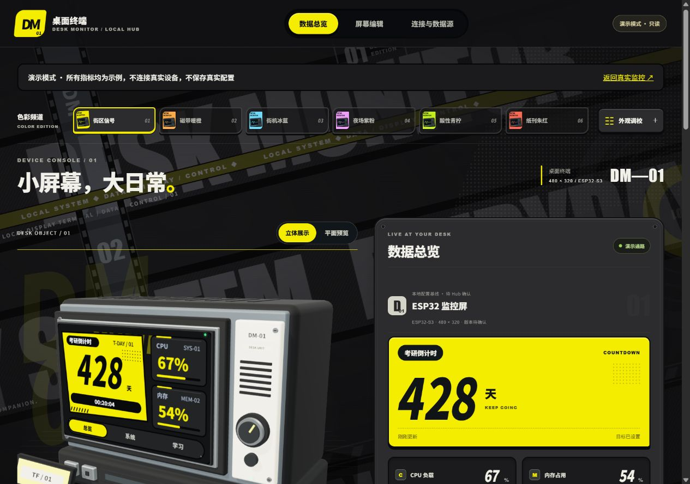

# zzz ESP32 Monitor Hub

**ESP32-S3 桌面监控系统：本机数据采集＋网页控制台＋触控屏固件。**
复古 CRT、街头排版、六套主题与原创 3D 终端；没有硬件也能使用。

当前开发分支包含设备固件 **0.4.0**：新增本地亮度／动效／屏保设置、可选学习控制、点阵时钟及完整按压高亮。实现与剩余验收见 [当前交接](docs/STATUS.md)；主分支与草稿PR的状态分别记录。



## 快速开始

Windows 安装 Node.js 22.21+，下载 [源码 ZIP](https://github.com/bydanmo/zzz-esp32-monitor-hub/archive/refs/heads/main.zip) 后双击 **`setup.cmd`**；或在根目录执行：

```powershell
npm ci
npm run build
npm start
```

打开 <http://127.0.0.1:8787/> 查看真实本机数据；`/?mode=demo` 进入明确标注的只读演示。
后续启停脚本在 [tools/windows](tools/windows)，详细配置见 [使用指南](docs/usage.md)。

## 按需要查看

| 分类 | 入口 |
| --- | --- |
| 应用源码 | [Hub](apps/hub) · [网页](apps/web) |
| ESP32 固件 | [配置、引脚与烧录](firmware/README.md) |
| 设计与开发 | [文档导航](docs/README.md) · [美术设计流程](docs/design/README.md) |
| 开发工具 | [Windows、固件、素材工具](tools/README.md) |
| 可选资源 | [0.4.0候选动画资源](https://github.com/bydanmo/zzz-esp32-monitor-hub/releases/tag/resources-v0.4.0) · [生成与导入](docs/media.md) |
| 学习与本地设置 | [学习接口与配对](docs/study-link.md) · [设备本地设置](firmware/README.md#本地设置) |

源码保留网页必需的小素材。ESP32 动画帧、离线 GLB 和评审导出单独提供；**不下载也能运行网页与监控**。
已验证 LCDWiki ES3C40P／480×320；Windows 优先，其他平台未验证。Hub 仅用于本机或可信局域网。

非官方爱好者项目，受《绝区零》视觉风格启发；默认素材为原创，不附带游戏截图或原作视频。
代码与原创图形采用 [MIT](LICENSE)，字体和依赖见 [许可说明](docs/THIRD_PARTY_NOTICES.md)。

## English

A local-first ESP32-S3 monitor with a telemetry Hub, web console and original retro CRT design.
Run `npm ci`, `npm run build`, `npm start`; hardware is optional. Windows is the tested platform.
Device animation frames and offline models are separate [optional downloads](https://github.com/bydanmo/zzz-esp32-monitor-hub/releases/tag/resources-v0.4.0).
